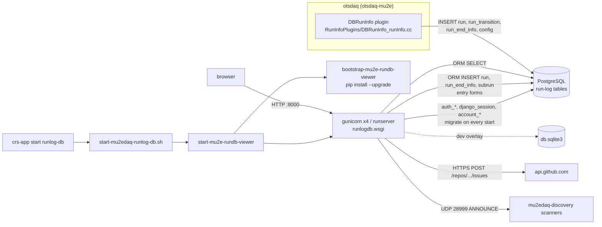

# mu2edaq-runlog-db

> Django web viewer and manual-entry tool for the Mu2e DAQ run-log database
> (runs, subruns, EWT lookup) on SQLite or the production PostgreSQL written
> by the otsdaq DBRunInfo plugin, served on port 8000

| | |
|---|---|
| Repository | `Mu2e/mu2edaq-runlog-db` (public, issues enabled) |
| Language | Python 3.9 (Docker base `python:3.9-slim`), Django 4.2, django-allauth 0.61 |
| Ports | 8000/tcp HTTP (gunicorn or `runserver`); 28999/udp discovery responder when `mu2edaq-discovery` is installed |
| Database | SQLite `db.sqlite3` (development) or PostgreSQL `localhost:5432/runlogdb` (production) |
| Depends on | `mu2edaq-discovery` (optional import); data written by `otsdaq-mu2e` `DBRunInfo` |
| Version | `t01.00.00` |
| Size | 2718 lines: Python 1481 (incl. 241-line migration), templates 971, shell 186, YAML 50, Dockerfile 30 |

## Purpose

The only Django application in mu2edaq-main. It gives shifters and run
coordinators a browser view of the run log: runs by time window, the subruns
of a run with event totals, and a lookup of which subrun contains a given
Event Window Tag (EWT). It also has forms that **insert** runs, run-end
comments and subruns by hand, and a page that files GitHub issues.

In production it reads the PostgreSQL run-log tables that the otsdaq run-info
plugin `DBRunInfo` writes at run transitions. In development it uses a local
SQLite file that `manage.py seed_db` fills with fake data.

## Architecture

Process model: in production `start-mu2e-rundb-viewer` runs gunicorn with
four synchronous workers, `--daemon` and a PID file
(`start-mu2e-rundb-viewer:67-71`); in development it backgrounds
`manage.py runserver --noreload` (`:82-84`). Inside Docker both run in the
foreground (`:56`, `:62`, `:79`). The discovery responder is a daemon thread
started from `RunsConfig.ready()` in every serving process
(`runs/apps.py:14-32`).

## Components

| File | Role |
|---|---|
| `runlogdb/settings.py` | Settings loader: `.env` (python-dotenv, no override), `config/default.yaml`, `config/<DJANGO_ENV>.yaml`, then `RUNLOGDB_*` env (`:16-85`). Chooses SQLite or PostgreSQL (`:94-111`), installs allauth with Google and one OIDC server (`:124-215`), and adds `DevBypassMiddleware` when auth is off (`:154-155`). |
| `runlogdb/db_router.py` | `ProductionRouter.allow_migrate` returns `False` for app `runs` on PostgreSQL (`:10-16`). It has no `db_for_read`/`db_for_write`; it does not make anything read-only. |
| `runlogdb/middleware.py` | `DevBypassMiddleware`: when auth is disabled, every unauthenticated request becomes user `dev`, created with `is_staff` and `is_superuser` (`:18-31`). |
| `runlogdb/urls.py` | `/` → `/runs/`, `runs/`, `accounts/` (allauth), `admin/` (`:5-10`). |
| `runs/models.py` | Nine models mapped onto the existing table names (`db_table`). `Run` and `RunEndInfo` use `run_number` as PK; `Subrun`, `RunTransition`, `Config`, `ArtdaqFcl` get Django's implicit `id` PK (`:75-158`). |
| `runs/views.py` | Three query views, three insert views, bug report, about. All but `about` are `@login_required` (`:16-245`). ORM only; no raw SQL. |
| `runs/forms.py` | Query and entry forms with range validation (`:17-221`). |
| `runs/apps.py` | Starts `mu2edaq_discovery.Responder` when serving (`:19-32`). |
| `runs/management/commands/seed_db.py`, `purge_db.py` | Fake-data generator and full delete of all nine tables (`purge_db.py:26-37`, `:69-73`). |
| `runs/migrations/0001_initial.py` | Creates the run-log tables on SQLite only. |
| `templates/` | Base layout (Tailwind from `cdn.tailwindcss.com`, `templates/base.html:7`), allauth overrides showing only SSO buttons. |
| `start-mu2edaq-runlog-db.sh`, `stop-mu2edaq-runlog-db.sh` | Control-room wrappers: map `CRS_PORT_HTTP` to `RUNLOGDB_PORT` and `exec` the scripts below. Regular files (mode 100755), not symlinks and not copies. |
| `start-mu2e-rundb-viewer`, `stop-mu2e-rundb-viewer`, `bootstrap-mu2e-rundb-viewer` | The real launcher, PID-file stopper and venv bootstrap. |
| `Dockerfile` | `python:3.9-slim`, venv at `/app/.venv`, `DJANGO_ENV=production`, `RUNLOGDB_HOST=0.0.0.0`, `EXPOSE 8000`. |
| `db-schema.txt` (= `columns_202605151137.txt`, byte-identical), `db-schema.md`, `db-schema-*.png` | Column dump of the production schema (2026-05-15) and the derived ER diagram. |

## Data source

The production tables are written by **`DBRunInfo`**, an otsdaq run-info
plugin in `otsdaq-mu2e` (`otsdaq-mu2e/RunInfoPlugins/DBRunInfo_runInfo.cc:1346`,
`DEFINE_OTS_PROCESSOR(DBRunInfo)`):

| Table | Writer | Evidence |
|---|---|---|
| `run` | `DBRunInfo`, number from the DB sequence (`RETURNING run_number`) | `DBRunInfo_runInfo.cc:902-910`; `db-schema.txt` `run_number` default `nextval('production.run_configuration_run_number_seq')` |
| `run_transition` | `DBRunInfo` | `DBRunInfo_runInfo.cc:1077` |
| `run_end_info` | `DBRunInfo` | `DBRunInfo_runInfo.cc:1115` |
| `config` | `DBRunInfo` | `DBRunInfo_runInfo.cc:491` |
| `subrun` | not `DBRunInfo` (no `subrun` reference in the plugin); writer not identified in mu2edaq-main | `grep -n subrun DBRunInfo*` → none |
| all of the above | this viewer's entry forms (`run`, `run_end_info`, `subrun`) and `seed_db`/`purge_db` | `runs/views.py:99`, `:120`, `:226` |

`DBRunInfo` connects with `OTSDAQ_RUNINFO_DATABASE` (default `run_info`) and
schema-qualifies every table with `OTSDAQ_RUNINFO_DATABASE_SCHEMA` (default
`test`) (`DBRunInfo_runInfo.cc:20-37`). The viewer's database name defaults to
`runlogdb` and it has no schema setting, so it sees the plugin's tables only
if the PostgreSQL role's `search_path` includes that schema. The column dump
shows sequences in schemas `production` and `test_sc`. Which database and
schema production actually uses is not recorded in either package.

## Interfaces

HTTP routes, authentication, database contract and discovery are in
[INTERFACES.md](INTERFACES.md).

## Configuration

Four layers (`runlogdb/settings.py:1-7`): `.env` → `config/default.yaml` →
`config/<DJANGO_ENV>.yaml` → `RUNLOGDB_*`. Full key list in
`man/man5/mu2edaq-runlog-db.yaml.5`.

| | `development.yaml` | `production.yaml` |
|---|---|---|
| backend | sqlite | postgres |
| auth.enabled | false (superuser `dev` auto-login) | true |
| debug | true | false |
| allowed_hosts | `*` | inherited `localhost`, `127.0.0.1` |
| secret_key | inherited `change-me-before-deploying` | inherited `change-me-before-deploying` |

**The start scripts decide `DJANGO_ENV`, not `.env`.**
`start-mu2e-rundb-viewer:39` exports `DJANGO_ENV=development` when it is
unset, and python-dotenv does not override an existing variable, so
`DJANGO_ENV=production` in `.env` is silently ignored (RL-002). Nothing in
mu2edaq-main sets `DJANGO_ENV` for the control-room launch.

## Operations

See [OPERATIONS.md](OPERATIONS.md).

## Interactions with other packages

| Package | Relation | Evidence |
|---|---|---|
| `otsdaq-mu2e` | its `DBRunInfo` plugin writes the production tables this app reads and also writes | `otsdaq-mu2e/otsdaq-mu2e/RunInfoPlugins/DBRunInfo_runInfo.cc:902`; `runs/models.py:39-57` |
| `mu2edaq-discovery` | optional import; announces `runlog-db` on UDP 28999 | `runs/apps.py:24` |
| `mu2edaq-controlroom-setup` | launches it (`crs-app start runlog-db`, `ports: {http: 8000}`, session `shift-aux`) | `mu2edaq-controlroom-setup/config/apps.yaml:97-105` |
| `mu2edaq-desktop` | desktop launcher entry | `mu2edaq-desktop/config/apps.yaml:98-105` |
| `mu2edaq-config` | snapshots of `config/default.yaml` (identical to the package copy in `config-main`) | `mu2edaq-config/config-main/mu2edaq-runlog-db/default.yaml` |

## Review findings

Staged in [ISSUES-PENDING.md](ISSUES-PENDING.md): 1 × S1, 5 × S2, 5 × S3, 2 × S4.

| ID | Sev | Title |
|---|---|---|
| RL-001 | S1 | `[auth] open allauth signup lets anyone who reaches :8000 create an account with read and write access to the run log` |
| RL-002 | S2 | `[config] the start script forces DJANGO_ENV=development ahead of .env, so control-room launches run with no auth, an auto-login superuser and an empty SQLite` |
| RL-003 | S2 | `[db] manual run entry and seed_db insert explicit run numbers behind the DAQ's sequence, so a later DAQ run start can fail on a duplicate key` |
| RL-004 | S2 | `[db] Subrun, RunTransition, Config and ArtdaqFcl models assume an id column the production tables do not have` |
| RL-005 | S2 | `[ops] purge_db and seed_db run against the production PostgreSQL with no backend guard` |
| RL-006 | S2 | `[config] production inherits a committed SECRET_KEY, localhost-only ALLOWED_HOSTS with no override, no HTTPS settings and a development Keycloak realm` |
| RL-007 | S3 | `[db] the viewer keeps its auth and session tables in the production run-log database, migrates on every start, and has no schema setting` |
| RL-008 | S3 | `[ops] every start runs pip install --upgrade against PyPI under set -e` |
| RL-009 | S3 | `[web] any logged-in user can file GitHub issues with the server's repo-scope token; no request timeout` |
| RL-010 | S3 | `[discovery] the responder advertises the host FQDN while the server binds 127.0.0.1, and gunicorn starts one responder per worker` |
| RL-011 | S3 | `[tests] no tests and no CI for an application that writes to the production run log` |
| RL-012 | S4 | `[ui] Tailwind is loaded from cdn.tailwindcss.com at runtime` |
| RL-013 | S4 | `[docs] duplicate schema dump, and setup docs that rely on .env for DJANGO_ENV` |

### Verdicts requested by the review brief

- **Authentication: the run log is open to anyone who reaches :8000.** In
  production mode every query and entry view is `@login_required`, but the
  allauth signup endpoint is live (the templates hide its form; the endpoint
  still accepts a POST) and grants full access, verified end-to-end (RL-001).
  Any Google account is also accepted. In development mode, which is what
  every control-room launch gets (RL-002), there is no authentication at all
  and every request is a superuser.
- **`SECRET_KEY`**: from `RUNLOGDB_SECRET_KEY`, else the committed
  `change-me-before-deploying` (`config/default.yaml:29`), also in production
  (RL-006).
- **`DEBUG`/`ALLOWED_HOSTS` in production**: `DEBUG` false;
  `ALLOWED_HOSTS` `localhost, 127.0.0.1` with no override (RL-006).
- **`db_router`**: it only stops migrations of the `runs` app on PostgreSQL.
  It does not prevent writes; the app writes to tables its own docstring says
  "must not be touched by Django" (RL-003, RL-005).
- **SQL by string formatting**: none in this package; all access is through
  the ORM. (The writer, `DBRunInfo`, builds SQL by string concatenation with a
  sanitised comment; that is outside this package and Tier B, not reviewed.)
